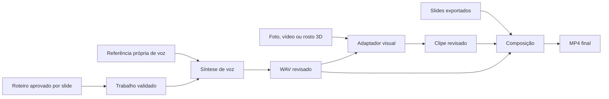

# Arquitetura proposta

Estado: desenho, sem aplicação implementada. Contexto: [briefing](BRIEF.md). Decisão de abordagem e fases: [plano](IMPLEMENTATION_PLAN.md). Medições necessárias: [validação](VALIDATION.md).

## Componentes e responsabilidades

| Componente proposto | Entrada | Saída | Limite |
| --- | --- | --- | --- |
| Editor de apresentação | Roteiro e slides exportados | Segmentos revisados e ordem | Não inventa fatos sobre a envasadora; texto aprovado pelo autor. |
| Cadastro de referência | Mídia própria e consentimento local | Perfil local versionado | Sem upload externo ou biometria no Git. |
| Adaptador de voz | Texto, referência e parâmetros explícitos | WAV e duração medida | Timbre, prosódia e estilo são avaliados separadamente. |
| Adaptador visual | WAV e referência de foto, vídeo ou rosto 3D | Clipe de avatar sem montagem final | Nenhuma troca silenciosa de modelo/dispositivo. |
| Compositor | Slides, clipes aprovados e durações | MP4 final e manifesto de exportação | Não aumenta a fidelidade facial ao aumentar o tamanho do arquivo. |
| Executor de trabalhos | Pacote validado e configuração local | Progresso, clipes e hashes | Um trabalho com GPU por vez no MVP. |
| Interface local | Estado dos trabalhos | Prévia, aprovação, cancelamento | Nasce após prova do pipeline por CLI; localhost por padrão. |

## Fluxo local do vídeo gravado



Os caminhos de foto, vídeo e 3D são adaptadores alternativos. O MVP homologa somente um deles. Modelos de voz e rosto executam sequencialmente e liberam memória entre estágios; 8 GB de VRAM não são compartilhados com outra máquina nem considerados disponíveis integralmente.

## Organização proposta dos dados locais

```text
private/profiles/       referências próprias e consentimento local
models/                checkpoints e manifestos de origem/licença
data/jobs/             entradas imutáveis por trabalho
runtime/               fila, estado, checkpoints e logs sanitizados
outputs/               prévias, clipes aprovados e MP4 final
```

Todos esses diretórios estão ignorados. Uma exclusão no Git não é criptografia nem backup. O catálogo de modelos guarda URL original, revisão, SHA-256 e licença específica em manifesto local; pesos não são redistribuídos.

## Voz, prosódia e estilo textual

- **Timbre:** semelhança da identidade vocal obtida por referência; depende do modelo e da gravação.
- **Prosódia:** pausas, ênfase, velocidade, entonação e pronúncia; controlabilidade varia por adaptador e precisa de escuta.
- **Estilo textual:** escolha de palavras e estrutura da explicação; fornecido por roteiro aprovado. LLM local é opcional posterior, não dependência do MVP.

Não há treinamento do zero, clonagem perfeita ou autonomia de conteúdo como requisito. Referências iniciais sugeridas são propostas de aquisição, sujeitas à documentação do checkpoint homologado.

## Isolamento de ambientes e dispositivos

Usar ambientes separados por adaptador, versões fixadas após teste e chamadas por subprocesso com argv explícito, sem comandos montados a partir do texto do usuário. Assim, dependências antigas do retrato não obrigam o TTS a usar o mesmo Python/PyTorch.

Dispositivos candidatos: CPU e AMD via runtime comprovado. Registrar backend efetivo; a string `cuda` em PyTorch também pode ser usada por ROCm e, sozinha, não identifica hardware NVIDIA. HIP SDK suportado não garante operadores ou extensões do pipeline. DirectML/ONNX só entram se houver caminho documentado e teste completo do adaptador; não são substituição transparente.

## Execução remota e fronteira entre computadores

Contrato proposto em [REMOTE_JOBS.md](REMOTE_JOBS.md). A primeira versão funciona inteiramente no desktop. O cliente remoto envia trabalho e recebe resultado; não divide camadas de uma rede neural entre computadores.

Nenhum serviço será exposto à internet nesta fase. Acesso remoto exige configuração própria posterior, autenticada, com autorização de instalação e credenciais quando necessário.

## Falhas e recuperação

Checkpoint por segmento e estágio; saída parcial nunca vira sucesso. Retentativa manual e limitada após diagnóstico; timeout gera falha observável. Perda de conexão com o cliente produz estado desconhecido no cliente, não cancelamento automático do processo remoto.

Cancelar encerra somente os subprocessos filhos do trabalho; não mata processos globais de Python/FFmpeg. Resultados temporários são promovidos por renomeação no mesmo volume depois de validação. Revisões e variantes anteriores são preservadas até limpeza escolhida pelo proprietário.
